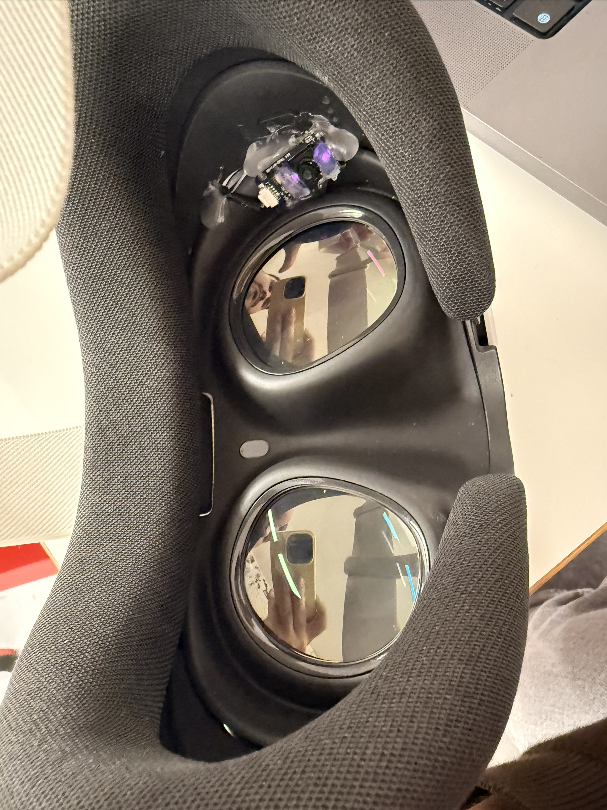

# gaze-XR-training

DIY eye tracking for the Meta Quest 3, used to see where people look during a VR training task.

The Quest 3 has no eye tracker. I mounted a small USB infrared camera inside the headset, track the pupil on my Mac and send the gaze to a Unity app running on the Quest. What I want to find out: what does a trainee look at, what do they miss, and how far can you trust those numbers when the tracker is cheap and home-built.



## Why

More and more industrial training happens in VR. Eye tracking could tell a trainer if someone read the instructions, or noticed a safety sign before picking up a tool. It is less clear which gaze metrics are reliable enough to base feedback on. I would rather test that on a working setup than argue about it in theory.

## How it works

```
IR camera (left eye, inside the Quest 3)
   | USB
Mac: Python pupil tracker -> gaze vector
   | UDP over Wi-Fi
Quest 3: Unity app -> calibration -> gaze ray -> which object is looked at
   | CSV log
Mac: analysis -> accuracy, dwell times, eye gaze vs head gaze
```

## Status

| Part | State |
|---|---|
| Camera mount in the Quest 3 | done (v1) |
| VR workstation scene | done, based on TacTool |
| Bright-pupil detection | in progress |
| Mac camera support, gaze over Wi-Fi | next |
| Calibration and accuracy test in the headset | planned |
| Training task, logging, analysis | planned |

The full plan is in [xr_training/docs/PLAN.md](xr_training/docs/PLAN.md).

## Hardware

- Meta Quest 3
- GC0308 USB camera module with two 850 nm IR LEDs, mounted above the left lens. I covered the LEDs with hot glue and paint to spread the light.
- USB cable extended by splicing in a 2 m USB-A cable
- MacBook Pro M1 Max (no Windows machine, so everything runs on macOS)

One thing I did not expect: inside the headset the LEDs sit so close to the camera lens that the retina reflects them straight back, and the pupil shows up bright instead of dark. Orlosky's tracker searches for a dark pupil, so I am writing a bright-pupil detector ([xr_training/tracker/bright_pupil.py](xr_training/tracker/bright_pupil.py)).

## Repo layout

```
xr_training/      my work
  docs/           plan, notes, result images
  tracker/        bright-pupil detector
  data/raw/       eye recordings from the headset
unity/            VR workstation project (Unity 6000.4.5f1, OpenXR, XR Interaction Toolkit)
media/            photos of the build
3DTracker/        Jason Orlosky's 3D eye tracker (Python), the base I build on
VREyeTracker/     his Unity calibration scripts
FrontCameraTracker/, HeadTracker/, Webcam3DTracker/,
OrloskyPupilDetector*.py, eye_test.mp4
                  other parts of his original project, not used yet
```

## Eye safety

The camera lights the eye with infrared from about 3 cm away. Jason Orlosky measured this camera module at 0.27 mW/cm² at 3 cm, far below the 10 mW/cm² screening limit he uses, and my diffusers should lower it further. I have not measured my own build yet. Until then only I wear it, in short sessions.

## Credits

- **Eye tracker:** Jason Orlosky, [JEOresearch/EyeTracker](https://github.com/JEOresearch/EyeTracker) (MIT) and his [DIY VR eye tracking guide](https://www.jeoresearch.com/vrtracker.html). This repo started from a snapshot of his code. I change it for macOS, the Quest 3 and bright-pupil tracking.
- **VR scene:** TacTool, which I built with my team in the DH2670 Haptics course at KTH. Used and extended with their permission.
- **3D models:** the packs in `unity/Assets/3D Assets` come from the Unity Asset Store and keep their own licenses. They are not covered by this repo's MIT license.

## License

MIT, see [LICENSE](LICENSE). The original tracker code is © 2024 JEOresearch, my changes and new code are © 2026 Fuad Mammadov.
