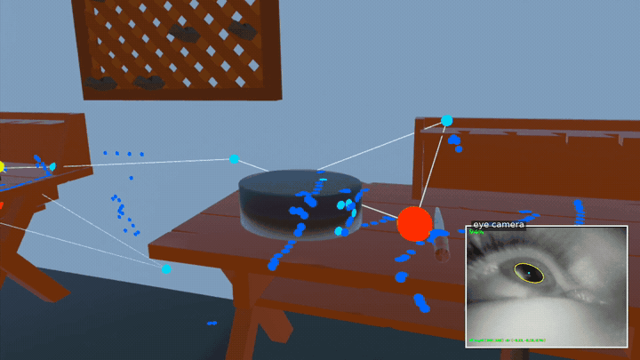
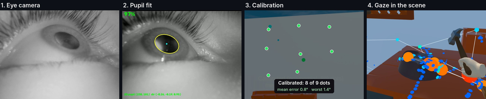
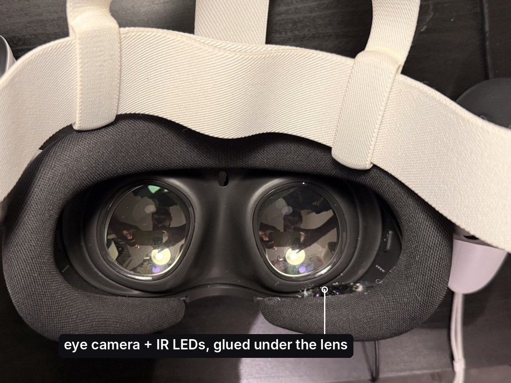
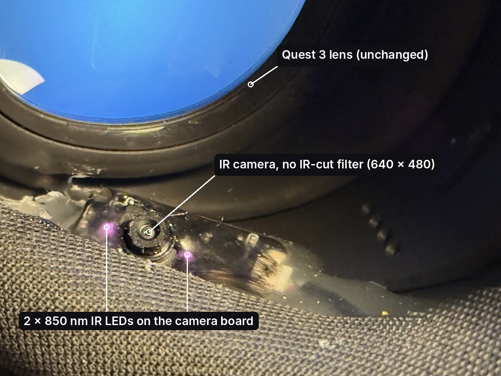
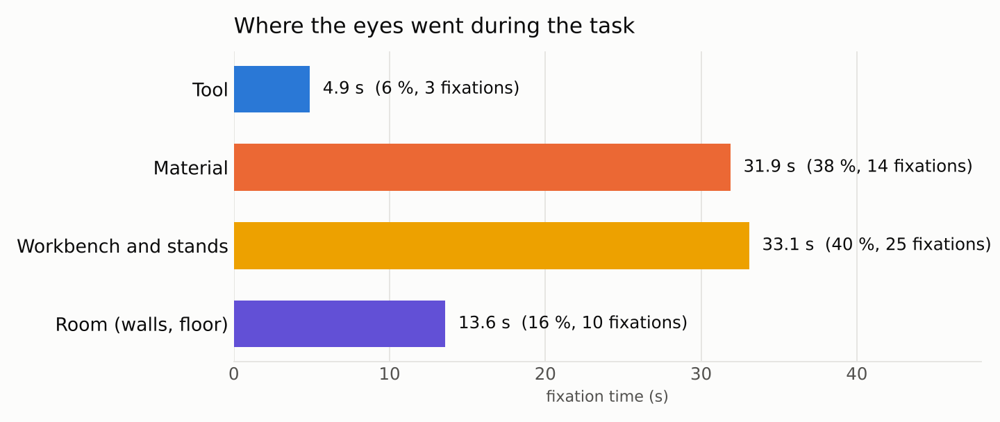
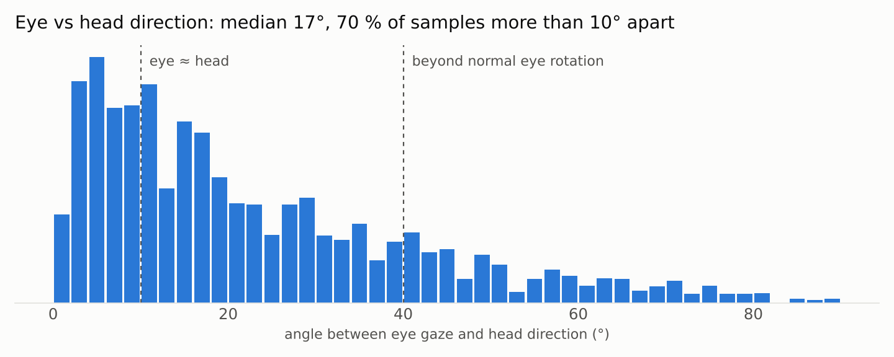
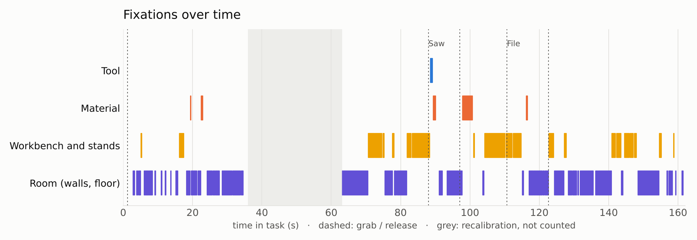

# Gaze-XR-training: Eye tracking for any Unity VR scene



     

Add eye tracking to a Unity VR scene and see what people actually look at while they use it. This tool provides live gaze, fixations, scanpaths and heatmaps inside the headset, plus a CSV log and synced videos for analysis afterwards.

The Meta Quest 3 has no eye tracker, so this repo also shows how to build one yourself with a small USB infrared camera glued under the lens, a pupil tracker on a Mac, and the gaze streamed to the headset over Wi-Fi. The Unity side does not care where gaze comes from, so the same scripts work with a headset that has eye tracking built in.

## About the project

As an example I first built a VR workbench in Unity for testing virtual tools: you shape clay, break rock with a hammer, saw wood. It was made for haptics experiments, and the obvious question afterwards was where people look while they work. Do they watch the tool, the material, or their hand? Do they read the instructions before they start?

So I added eye tracking to it and used the workbench as the test case. The goal was a setup anyone can copy:

- **Hardware** that costs less than a game and fits inside a Quest 3.
- **A gaze toolkit for Unity** that you drop onto the camera of your own scene.
- **A session workflow** that gives you numbers and videos without manual work.

## What you get

| | |
|---|---|
| **Live gaze in the headset** | a gaze dot, fixation spheres that grow while you look, lines between fixations (the scanpath) and a heatmap on the surfaces you look at |
| **9-dot calibration** | automatic, shows its own error in the headset right after (dots + mean and worst error in degrees) |
| **Accuracy grid** | 25 targets before and after a task, so you can see accuracy and drift per session |
| **Areas of interest** | tag objects (tool, material, instruction, safety sign) and the log tells you which one was looked at |
| **Session log (CSV)** | per frame: head pose, eye gaze ray, confidence, looked-at object for eye and for head; events for grabs, hits, fixations and calibration |
| **One-button session** | right controller A runs calibration, grid, task and grid again, with instructions in the headset |
| **Recording and video tools** | eye video and gaze packets saved on the Mac, headset video, scripts that sync them into side-by-side or picture-in-picture clips and GIFs |

## Use cases

- **VR training:** did the trainee look at the safety sign before picking up the hammer? How long did they spend on the instructions?
- **Usability tests of VR interfaces:** which buttons and labels get noticed, which are never looked at.
- **Tool and haptics studies:** does a better haptic tool let people look at the work instead of the tool?
- **Comparing eye gaze with head direction:** many VR studies use the head as a proxy for attention. The log has both, so you can measure how often they disagree.
- **Teaching and demos:** a cheap way to show students what eye tracking data looks like and where it breaks.

## How it works



1. **Eye camera.** An IR camera under the lens films the eye.
2. **Pupil fit.** The Mac finds the pupil outline and its centre, about 10 ms per frame.
3. **Calibration.** Nine dots map pupil position to gaze direction. This run: 0.8° mean, 1.4° worst.
4. **Gaze in the scene.** The gaze ray hits the scene: fixations, scanpath, heatmap, looked-at object.


Every gaze packet has a sequence number. The Mac saves it with the eye video and the headset saves it in its log, so both sides line up frame by frame later.

## Hardware

 

| Part | Notes |
|---|---|
| Meta Quest 3 | developer mode on, optics not modified |
| GC0308 USB camera module with two 850 nm IR LEDs | sold for about €10 as a "120 fps" mini camera. It has no IR-cut filter, so it sees the eye in infrared. |
| Hot glue, paint for the LEDs | the camera board is glued under the lens and points up at the pupil. Glue and paint over the LEDs spread the light. |
| USB extension | the camera cable is extended with a 2 m USB-A cable to reach the Mac |
| Mac (Apple silicon) | runs the tracker. Everything here works on macOS, no Windows PC or SteamVR needed. |

**Mounting tips.** Aim the camera before the glue sets, with the tracker window open. Looking straight ahead, the pupil should sit near the middle of the frame and look roughly round. A camera that looks up from too far below sees a flat sliver of pupil and the tracking gets bad. Tape the cable so it cannot pull the camera.

## Set it up yourself

**You need:** Unity 6 with Android build support, a Quest in developer mode, a Mac with Python 3.12, and an IR camera inside the headset (see Hardware). Mac and Quest on the same Wi-Fi.

**1. Tracker on the Mac**
```bash
git clone https://github.com/fammad/gaze-XR-training.git
cd gaze-XR-training
python3 -m venv .venv && source .venv/bin/activate
pip install -r requirements.txt
python tracker/eye_tracker.py --camera 0 --no-udp
```
Wear the headset and check that the yellow ellipse sits on your pupil. No camera yet? Try the sample: `python tracker/eye_tracker.py --video data/samples/gaze_sweep.mov --no-udp`.

**2. Add gaze to your scene.** Copy `unity/Assets/GazeXR/` into your project and put these components on the XR camera (Main Camera under XR Origin):

| Component | Does |
|---|---|
| `MonoGazeTracker` | receives gaze, calibrates, gives the gaze ray to everything else |
| `GazeLogger` | writes the per-frame CSV |
| `AccuracyGrid` | 25-point accuracy test |
| `GazeHeatmap`, `GazeScanpath` | live visualisation |
| `SessionRunner` | one-button session |

Then add `GazeAOI` to the objects you care about and pick a category. They need a collider. Full details: [docs/unity_setup.md](docs/unity_setup.md).

**3. Build** to the Quest (File > Build And Run).

**4. Run a session**
```bash
tools/run_session.sh <QUEST_IP>
```
In the headset, press **A** and follow the instructions. Press Enter on the Mac when you are done. Everything lands in `sessions/<date_time>/`: eye video, gaze packets, headset video and the headset logs.

| Right controller | |
|---|---|
| A | start the session, end the task |
| B | recalibrate |
| Thumbstick click | view: heatmap, scanpath, both, off |

**5. Analyse**
```bash
python tools/analyze_session.py sessions/<date_time>/headset_logs/session_<...>.csv
```
Writes the dwell, timeline and eye vs head figures plus a summary table to `docs/analysis/`.

## Results

Single user (me), one Quest 3. Not a study, a check of what the pipeline can measure. Numbers below are from the session with the best calibration.

| | |
|---|---|
| Calibration fit (9 dots, polynomial map) | **0.8° mean, 1.4° worst** |
| Accuracy grid right after calibration (25 targets, ±15° × ±10°) | **5.4° in the centre, 9.1° median** |
| Accuracy grid after the task (about 3 minutes later) | 11.7° in the centre, 16.9° median |
| Precision (sample-to-sample, median over targets) | 0.9° |
| Frames with the pupil found | 92 to 93 % |
| Gaze rate reaching the headset | about 10 per second |

**The calibration fit is not the accuracy.** The fit is measured on the same dots it was made from. The independent grid shows the real error: about 5° near the centre, worse toward the edges, and it doubles over a few minutes as the headset shifts on the face. Precision stays under 1°, so the gaze is stable but offset. That points at headset slip, not at the pupil detection. I also grabbed a tool during the first grid, which adds some error there.

### What one task session shows

`tools/analyze_session.py` turns a headset log into the figures below: 99 seconds of work with saw, hammer and file, calibration and accuracy checks cut out.

 


What I read from it:

- **Large things are measurable, small ones are not.** Material blocks and the workbench got 78 % of the fixation time, tools 6 %. A tool handle at 60 cm is about 4° wide, smaller than the error, so gaze meant for a tool often lands next to it.
- **The rule break is the interesting moment, and the hardest to judge.** Four forbidden hammer hits on the marble fell inside one long fixation logged on the workbench next to the marble. With about 5° error I cannot say whether I looked at the marble or not. This is exactly the question a trainer would ask, and it shows the accuracy a tracker needs before the answer can be trusted.
- **The head is a poor stand-in for the eyes.** In 63 % of samples, eye gaze and head direction were more than 10° apart (median 12°). Logging only head direction would often name the wrong object.
- **A quality filter is cheap and needed.** 1 % of samples put the eye more than 40° off the head direction, more than eyes normally turn. Those are tracking errors and get removed.
- **The timeline shows the work rhythm.** Material and bench fixations around each grab, short looks at the room in between.

One session from one person: examples of what the pipeline shows, not findings about people.

## Blueprint: which gaze metrics this setup can support

Based on the measured accuracy (about 5° in the centre after calibration, getting worse with headset slip), precision (under 1°) and rate (about 10 samples per second). A commercial headset tracker (about 1°, 90 Hz or more) moves most rows to "yes".

| Metric | What it tells a trainer | What it needs | This setup |
|---|---|---|---|
| Dwell time per object | which parts of the station get attention | accuracy well below the object's angular size | yes for large objects (bench, material blocks, instruction boards); no for tools |
| Seen or not seen before an action (a safety sign before the first grab, the material before a hit) | procedure followed, cue noticed | events in the same log as gaze, object about three times the error | partly: the events are there, but small or close objects are ambiguous (see the marble) |
| Order of fixations (scanpath) | planning, searching vs knowing where to look | fixation detection, about 100 ms timing | coarse: about 100 ms resolution at 10 Hz |
| Fixation count and duration | searching vs focused work, uncertainty | 30 Hz or more for durations you can compare | rough only |
| Eye vs head direction | whether a cheaper head-only setup would be enough | eye tracking | yes, and here the answer was no |
| Saccade speed, pupil size (workload) | effort, stress | 120 Hz or more, controlled light | no |
| Accuracy before and after the task | how far to trust the session | a short grid at the start and end | yes, built into the session |

**Rules of thumb from building it**

1. Never report the calibration fit as accuracy. Check with separate targets at the start and the end of every session, and drop sessions where it falls apart.
2. Design areas of interest from the accuracy you have: about three times the error. At 5° that is about 15°, roughly a 15 cm object at arm's length. At 1° (a good commercial tracker) it is a 3 cm object.
3. Log task events next to gaze. "Looked at the material before hitting it" is one join, and it is the kind of question trainers ask.
4. Filter physiologically impossible gaze before computing anything.
5. Record the eye video. When a number looks odd, the video tells you whether it was the person or the tracker.

## Problems and solutions

| Problem | What I did |
|---|---|
| The tracker I started from was written for Windows | macOS camera backend (AVFoundation), new file picker, flip option, command-line mode for recorded videos |
| No SteamVR and no PC link on a Mac | the app runs standalone on the Quest and gaze comes over Wi-Fi as UDP packets |
| The pupil looked bright, then half bright and half dark, because the LEDs sit next to the camera lens | a pupil detector that follows the pupil outline whichever way the edge goes, then fits an ellipse with RANSAC |
| The detector fitted only one half of the pupil | ray casting from several start points inside the pupil, keeping the fit that the edges support best |
| The 3D eyeball model needed a manual step and drifted | 2D pupil position plus a 9-dot calibration in the headset, with the error shown right away |
| Detection was slow (about 4 gaze samples per second) | rays computed in one go and a search window around the last pupil: about 10 ms per frame |
| One-frame jumps to eyelashes and reflections | a jump is only accepted if the next frame agrees |
| Gaze dots turned magenta on the Quest | the default material is not drawn by URP in a build; all gaze visuals now use an unlit URP material that is always included |
| The heatmap drew dotted lines during eye jumps | only fixations are painted (velocity threshold, I-VT) |

## Limitations

- **One eye, 2D pupil tracking.** No corneal reflection yet, so if the headset slides on the face the gaze shifts. Recalibrate after you adjust the headset.
- **About 10 gaze samples per second.** Enough for fixations on objects, not for saccade analysis. Commercial VR trackers run at 90 to 200 Hz.
- **Tested on one person.** Eyelids, lashes, glasses and make-up will change how well the pupil is found.
- **The Mac is in the loop.** The headset needs the Wi-Fi link to the Mac for gaze.

## Future work

- **Commercial headsets through OpenXR.** Read gaze from the OpenXR eye gaze extension (`XR_EXT_eye_gaze_interaction`, supported on Quest Pro, Varjo, Pico and HTC) as a second gaze source next to UDP. The calibration check, logging, AOIs and visualisations stay the same.
- **VR vs real work.** Run the same task and the same object groups with wearable eye-tracking glasses at a real station, and compare dwell and order between VR and reality.
- **Slip correction.** Use the LED reflections on the cornea (glints) as a reference, so headset movement does not shift the gaze.
- **Higher rate.** The camera can run faster at lower resolution; the detector already runs at about 10 ms per frame.
- **A user study.** More people, a fixed task, and object groups tagged with `GazeAOI` in the scene.

## Eye safety

The camera lights the eye with infrared from about 3 cm. Jason Orlosky measured this camera module at 0.27 mW/cm² at 3 cm, far below the 10 mW/cm² screening limit he uses, and the glue and paint over the LEDs lower it further. I have not measured my own build. If you build one, read his safety notes first, keep sessions short, and do not put it on other people without a measurement.

## Repository

```
tracker/      eye tracker (Python): eye_tracker.py, pupil detectors
tools/        run_session.sh, analyze_session.py, make_gif.py, make_pip.py, check_video.py, udp_listen.py
unity/        Unity 6 project, gaze scripts in unity/Assets/GazeXR/
docs/         Unity setup guide, analysis figures, development images
media/        images and videos for this page
data/samples/ a short eye video to try the tracker without hardware
```

## Citation

If you use this toolkit, the hardware build or the data in your work, please cite it:

```bibtex
@software{mammadov2026gazexr,
  author  = {Mammadov, Fuad},
  title   = {gaze-XR-training: Eye Tracking for Unity VR Scenes with a DIY Infrared Camera},
  year    = {2026},
  url     = {https://github.com/fammad/gaze-XR-training},
  license = {Apache-2.0}
}
```

```text
Mammadov, F. (2026). gaze-XR-training: Eye tracking for Unity VR scenes with a DIY infrared camera [Computer software]. https://github.com/fammad/gaze-XR-training
```

GitHub also shows a "Cite this repository" button (from [CITATION.cff](CITATION.cff)).

## Credits and Licence

- **Eye tracker base:** the Python 3D eye tracker and the Unity gaze script started from [JEOresearch/EyeTracker](https://github.com/JEOresearch/EyeTracker) by Jason Orlosky (MIT), and the hardware idea from his [DIY VR eye tracking guide](https://www.jeoresearch.com/vrtracker.html). Both were changed a lot here; the original license is kept in [THIRD_PARTY_NOTICES.md](THIRD_PARTY_NOTICES.md).
- **VR workbench:** built with my team in the DH2670 Haptics course at KTH, used here with their permission.

[Apache License 2.0](LICENSE). Code derived from JEOresearch/EyeTracker stays under its MIT license, see [THIRD_PARTY_NOTICES.md](THIRD_PARTY_NOTICES.md) and [NOTICE](NOTICE).

## References

- Orlosky, J. *DIY Eye Tracking for VR.* JEO Research. https://www.jeoresearch.com/vrtracker.html
- JEOresearch/EyeTracker. https://github.com/JEOresearch/EyeTracker
- Salvucci, D. D., & Goldberg, J. H. (2000). Identifying fixations and saccades in eye-tracking protocols. *Proceedings of ETRA 2000*, 71–78.
- Holmqvist, K., et al. (2011). *Eye Tracking: A Comprehensive Guide to Methods and Measures.* Oxford University Press.
